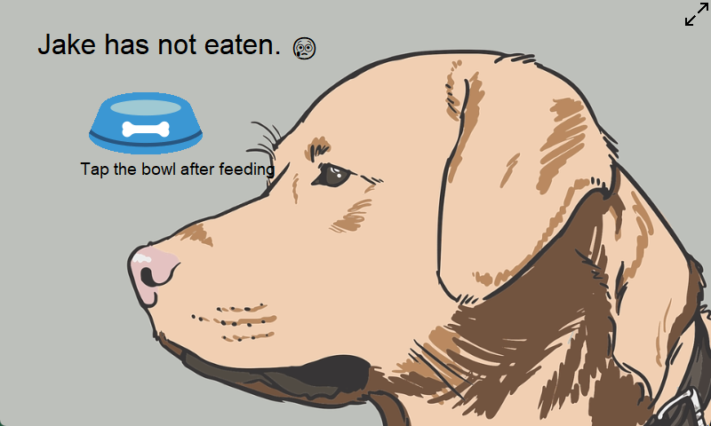

# AnimalTimer

AnimalTimer is a small desktop app that shows whether your pet has been fed and
counts down to the next meal. Tap the bowl after feeding, and the app shows a
countdown until the next feeding window starts. The app uses a fixed 800×480
window that you can switch to fullscreen.

This README is for anyone who wants to run the app from source or adapt it for
their own pet.



## Requirements

- Python 3.6 or later, with Tkinter. Tkinter is included with the standard
  Python installers for Windows and macOS. On Debian or Ubuntu, install the
  `python3-tk` package.
- [Pillow](https://pypi.org/project/pillow/)

## Install

1. Clone the repository:

   ```sh
   git clone https://github.com/Reskilling/Feeding-Timer.git
   ```

2. Go to the project directory:

   ```sh
   cd Feeding-Timer
   ```

3. Install Pillow:

   ```sh
   pip install pillow
   ```

## Run the app

To start the app, run the following command:

```sh
python AnimalTimer.py
```

The window shows "Jake has not eaten." and a food bowl.

## Record a feeding

1. After you feed your pet, tap the bowl.

   The message changes to "Jake has been fed!", and a countdown shows the time
   until the next meal.

2. Optional: If you tapped the bowl by mistake, tap **Undo**.

When the countdown reaches zero, the bowl reappears and the app shows that your
pet hasn't eaten.

The countdown ends at the next feeding window:

| If you tap the bowl | The countdown ends at |
|---|---|
| Before 06:00 | 06:00 the same day |
| From 06:00 until 16:30 | 16:30 the same day |
| At or after 16:30 | 06:00 the next day |

The app doesn't save its state. If you close or restart it, it starts again in
the "not eaten" state.

## Use fullscreen mode

- To enter or leave fullscreen, tap the arrows icon in the top-right corner.
- To leave fullscreen from the keyboard, press **Esc**.

## Customize the app

To change the app's behavior, edit the `AppConfig` class in `AnimalTimer.py`.
The following settings are available:

| Setting | Description | Default |
|---|---|---|
| `PET_NAME` | The name shown in the status messages. | `"Jake"` |
| `APP_TITLE` | The window title. | `"AnimalTimer"` |
| `RESET_TIME_MORNING` | The start of the morning feeding window, as `(hour, minute)`. | `(6, 0)` |
| `RESET_TIME_EVENING` | The start of the evening feeding window, as `(hour, minute)`. | `(16, 30)` |
| `WINDOW_SIZE` | The window size in pixels, as `(width, height)`. Match it to your background image. | `(800, 480)` |
| `UPDATE_INTERVAL` | How often the countdown refreshes, in milliseconds. | `1000` |
| `FONT_STYLE` | The font for the status message. | `("Cooper Black", 24)` |
| `TEXT_COLOR` | The color of all text. | `"black"` |

To use your own artwork, replace `background.png` and `bowl.gif`.

## Run the tests

To run the unit tests, run the following command from the project directory:

```sh
python -m unittest discover -s tests
```

## License

This project is licensed under the MIT License. For details, see
[LICENSE](LICENSE).
